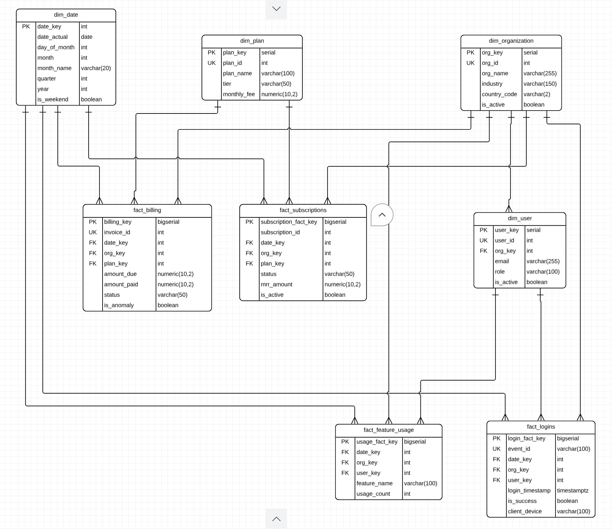

# Azure SaaS Medallion Lakehouse

## Overview

An end-to-end, automated enterprise data lakehouse built on Microsoft
Azure and Databricks following the **Medallion
Architecture (Bronze $\rightarrow$ Silver $\rightarrow$ Gold)**.

The platform ingests heterogeneous SaaS data sources (relational OLTP
database, telemetry CSV batch drops, and nested JSON API event streams),
cleanses and conforms records using a parameterized PySpark engine, and
models business data into an analytical **Kimball Star Schema** using
pure path-based **Delta Lake** on Azure Data Lake Storage Gen2 (ADLS
Gen2).

The type of model used here is a **Galaxy Schema** optimized for SaaS executive analytics, including:

- Monthly Recurring Revenue (MRR)
- Customer churn
- Feature engagement
- Daily Active User (DAU) tracking

---

## Architecture Overview

```text
                                    DATA SOURCES
        ┌───────────────────────┬────────────────────────┬─────────────────────┐
        │   Azure SQL / OLTP    │      Flat-File CSV     │    REST API (JSON)  │
        │   (Plans, Orgs, Users,│      (Product Feature  │    (Authentication  │
        │    Subs, Invoices)    │       Usage Telemetry) │     Login Events)   │
        └───────────┬───────────┴───────────┬────────────┴──────────┬──────────┘
                    │                       │                       │
                    └───────────────────────┼───────────────────────┘
                                            ▼
                    ┌───────────────────────────────────────────────┐
                    │      Azure Data Factory (Orchestration)       │
                    │  - Dynamic watermark control via Azure SQL    │
                    │  - Metadata audit lineage logging             │
                    └───────────────────────┬───────────────────────┘
                                            │
                                            ▼
═════════════════════════════════════════════════════════════════════════════════════════
 LAYER 1: BRONZE / RAW LANDING (`abfss://bronze@...`)
 - Format: Native Parquet & Raw Multi-line JSON
 - Retention: Immutable, append-only history with ingestion year/month partitioning
═════════════════════════════════════════════════════════════════════════════════════════
                                            │
                                            ▼ (Azure Databricks: `02_transform_silver.py`)
═════════════════════════════════════════════════════════════════════════════════════════
 LAYER 2: SILVER / CONFORMED DELTA TABLES (`abfss://silver@...`)
 - Format: Open-Source Delta Lake (ACID Transaction Logs in `_delta_log/`)
 - Operations: PySpark schema normalization, JSON array unnesting, 10 DQ cleaning rules
 - Ingestion Pattern: Idempotent SCD Type 1 `MERGE INTO` updates
═════════════════════════════════════════════════════════════════════════════════════════
                                            │
                                            ▼ (Azure Databricks: `03_transform_gold.py`)
═════════════════════════════════════════════════════════════════════════════════════════
 LAYER 3: GOLD / ANALYTICS DIMENSIONAL MODEL (`abfss://gold@...`)
 - Model: Kimball Star Schema (Conformed Dimensions & Event/Snapshot Facts)
 - Keys: Warehouse-managed surrogate integer keys + `-1` Unknown Member pattern
 - Consumption: Power BI Direct Lake / Databricks SQL for Executive SaaS KPIs (MRR, DAU)
═════════════════════════════════════════════════════════════════════════════════════════
```

### Storage Sovereignty: Pure Path-Based Delta Lake

The lakehouse operates under a **pure path-based strategy**
(`DeltaTable.forPath(spark, "abfss://...")` and
`delta.`abfss://...\``). All commit logs (`\_delta_log/\`), Parquet
columnar files, and time-travel versions reside directly inside
customer-managed ADLS Gen2 containers. This design completely eliminates
vendor lock-in, avoiding proprietary metastore boundaries while
maintaining open cross-engine accessibility for Synapse, Fabric, and
external Spark engines.

---

## Tech Stack

- **Cloud Infrastructure:** Microsoft Azure (ADLS Gen2, Azure Data
  Factory, Azure SQL Database, Azure Key Vault)
- **Processing & Compute:** Azure Databricks (Apache Spark, PySpark,
  Delta Lake)
- **Storage Format:** Open-Source Delta Lake (ACID transactions,
  schema enforcement, time-travel history)
- **Metadata & Control Plane:** Azure SQL Database
  (`etl_control.watermark_control`, `etl_control.pipeline_log`)
- **Security:** Azure Key Vault (Managed secret scopes, token
  authentication, connection strings)
- **Language & Quality:** Python 3.11, PySpark, Flake8, Pytest
- **CI/CD & DevOps:** GitHub Actions, Databricks CLI, Azure Data
  Factory Git Integration

---

## Data Sources & Ingestion Matrix

---

Source Entity Format Ingestion Primary Key / Grain Target Bronze Path
Pattern

---

**`plans`** Relational Full Overwrite `plan_id` `bronze/sql_plans/`
Table

**`organizations`** Relational Incremental `org_id` `bronze/sql_organizations/`
Table via  
 `updated_at`

**`users`** Relational Incremental `user_id` `bronze/sql_users/`
Table via  
 `updated_at`

**`subscriptions`** Relational Incremental `subscription_id` `bronze/sql_subscriptions/`
Table via  
 `updated_at`

**`invoices`** Relational Incremental `invoice_id` `bronze/sql_invoices/`
Table via  
 `updated_at`

**`feature_usage`** Flat File Periodic Batch `(user_id, org_id, date, feature)` `bronze/file_feature_usage/`
(CSV) Drop

**`logins`** REST API Incremental `event_id` `bronze/api_logins/`
(JSON) via Timestamp

---

---

## Data Model (Gold Layer Star Schema)



| Table                  | Primary Key             | Foreign Keys                      | Fact Grain / Role                                           |
| ---------------------- | ----------------------- | --------------------------------- | ----------------------------------------------------------- |
| **dim_date**           | `date_key`              | —                                 | Pre-computed calendar dimensions (YYYYMMDD)                 |
| **dim_plan**           | `plan_key`              | —                                 | Conformed pricing plan definitions (`plan_id` natural key)  |
| **dim_organization**   | `org_key`               | —                                 | Customer account profiles (`org_id` natural key)            |
| **dim_user**           | `user_key`              | `org_key` → `dim_organization`    | User identity profiles (`user_id` natural key)              |
| **fact_billing**       | `billing_key`           | `date_key`, `org_key`, `plan_key` | One row per issued invoice (`invoice_id` natural key)       |
| **fact_subscriptions** | `subscription_fact_key` | `date_key`, `org_key`, `plan_key` | One row per subscription lifecycle/snapshot state           |
| **fact_feature_usage** | `usage_fact_key`        | `date_key`, `org_key`, `user_key` | One row per user, per org, per feature, per date            |
| **fact_logins**        | `login_fact_key`        | `date_key`, `org_key`, `user_key` | One row per authentication attempt (`event_id` natural key) |

### Kimball Orphan Protection (`-1` Unknown Member)

To prevent joins from dropping fact records when relational sources
contain soft-deleted or unregistered parent IDs, every dimension
pre-seeds an explicit `-1` surrogate key ("Unknown"). Unmatched foreign
keys coalesce to `-1`, preserving complete financial totals during
aggregations.

---

## Core Data Engineering Features

### 1. Watermark-Driven State Management

Incremental runs read from an Azure SQL control table
(`etl_control.watermark_control`). The pipeline dynamically tracks
in-flight extractions and updates watermarks only upon verified
downstream completion:

```sql
SELECT entity_name, last_processed_watermark, last_run_status
FROM etl_control.watermark_control
WHERE is_active = 1;
```

### 2. Parameterized Silver Transformation Engine

A single PySpark notebook (`02_transform_silver.py`) accepts dynamic
Databricks widgets (`p_entity_name`, `p_run_mode`) to process all
entities consistently. It applies 10 real-world data hygiene rules:

- **JSON Array Unnesting:** Multi-line nested arrays from raw identity
  API drops exploded via `F.explode("data")`.
- **ISO Country Standardization:** Normalized country variations
  (`"USA"`, `"United States"`, `"Germany"`) into ISO-3166-1 alpha-2
  codes.
- **Email Sanitization & Syntax Validation:** Regex enforcement
  (`^[\w\.-]+@[\w\.-]+\.\w+$`), flagging malformed emails and
  standardizing fallbacks.
- **Date Parsing Coalescence:** Resiliently resolves mixed dates
  (`YYYY-MM-DD`, `MM/dd/yyyy`, `dd-MM-yyyy`) without throwing parse
  exceptions.
- **Numeric Cleaning:** Stripping currency symbols (`$`, `,`) and
  clamping negative telemetry usage anomalies.
- **UTC Timezone Unification:** Explicit offset alignment via
  `to_utc_timestamp`.
- **Deduplication:** Network retry burst elimination using window
  partitions over natural keys ordered by timestamp.

### 3. Idempotent Delta Lake Merges

Silver and Gold loading logic utilizes `DeltaTable.forPath` to execute
atomic SCD-1 upserts:

```python
delta_target.alias("target").merge(
    df_clean.alias("source"),
    match_predicate
).whenMatchedUpdateAll() \
 .whenNotMatchedInsertAll() \
 .execute()
```

---

## Project Structure

```text
azure-saas-lakehouse/
├── .github/
│   └── workflows/
│       └── ci_cd.yml                 # Automated test validation & Databricks CLI deployment
├── adf/                              # Version-controlled Azure Data Factory JSON templates
│   ├── pipeline/
│   ├── dataset/
│   └── linkedService/
├── databricks/
│   └── notebooks/
│       ├── common/
│       │   └── 01_lakehouse_config.py   # ADLS Gen2 paths & Key Vault secret resolution
│       ├── silver/
│       │   └── 02_transform_silver.py   # Parameterized conformed cleaning engine
│       └── gold/
│           └── 03_transform_gold.py     # Kimball Star Schema dimensional loader
├── sql/
│   ├── 01_azure_sql_oltp_ddl.sql      # DDL for watermark_control & pipeline_log
│   └── 02_etl_control.sql      # SPs: sp_log_start, sp_log_complete, sp_update_watermark
│   └── 03_stored_procedures.sql
├── tests/
│   └── test_transformations.py       # Unit tests verifying custom regex and sanitization rules
├── requirements-dev.txt              # Development & testing dependencies (pytest, flake8)
└── README.md
```

---

## Pipeline Orchestration & DevOps Automation

### End-to-End Orchestration (Azure Data Factory)

The master orchestrator pipeline (`pl_master_orchestrator`) manages full
execution dependencies:

1.  **Lookup & Iterate:** Fetches active entities from
    `etl_control.watermark_control` and loops via `ForEach`.
2.  **Bronze Ingestion:** Executes `pl_ingest_source_to_bronze` passing
    runtime watermark boundaries.
3.  **Silver Transformation:** Invokes `02_transform_silver.py` on Azure
    Databricks with dynamic entity arguments.
4.  **Gold Refresh:** Executes `03_transform_gold.py` downstream of the
    loop to update the dimensional Star Schema.

### CI/CD Workflow (GitHub Actions)

A lightweight GitHub Actions workflow (`ci_cd.yml`) automates software
delivery and validation:

- **Continuous Integration:** Every pull request and push to `main`
  runs `flake8` for syntax hygiene and executes `pytest` against
  transformation sanitization rules.
- **Continuous Delivery:** Once tests pass, the Databricks CLI
  automatically synchronizes approved notebooks from
  `databricks/notebooks/` directly into the target Databricks
  workspace path.

```yaml
# Simplified extract of .github/workflows/ci_cd.yml
- name: Run Tests
  run: pytest tests/ -v

- name: Deploy Notebooks to Databricks
  if: github.ref == 'refs/heads/main' && github.event_name == 'push'
  run: |
    databricks workspace import-dir databricks/notebooks /Workspace/Shared/azure-saas-lakehouse --overwrite
```

---

## Setup & Deployment Guide

### 1. Prerequisites

- Azure Subscription with an active resource group.
- Provisioned ADLS Gen2 account containing three containers: `bronze`,
  `silver`, and `gold`.
- Azure Databricks workspace with an active interactive cluster
  (Runtime 13.3+ LTS recommended).
- Azure SQL Database for pipeline metadata control.
- Azure Key Vault configured with a Databricks Secret Scope
  (`akv-scope`).

### 2. Azure SQL Metadata Setup

Connect to your Azure SQL Database and execute the control DDLs:

```bash
sqlcmd -S <server>.database.windows.net -d <database> -U <user> -P <password> -i sql/01_azure_sql_oltp_ddl.sql
sqlcmd -S <server>.database.windows.net -d <database> -U <user> -P <password> -i sql/02_init_etl_control.sql
sqlcmd -S <server>.database.windows.net -d <database> -U <user> -P <password> -i sql/03_stored_procedures.sql
```

### 3. Local Test Suite Execution

Verify data quality functions and regex rules locally:

```bash
python -m venv venv
source venv/bin/activate       # On Windows: .\venv\Scripts\Activate.ps1
pip install -r requirements-dev.txt

flake8 tests/
pytest tests/ -v
```

### 4. Running the Master Pipeline

1.  In Azure Data Factory Studio, open `pl_master_orchestrator`.
2.  Ensure the Databricks linked service (`ls_azure_databricks`)
    connects successfully to your cluster.
3.  Click **Debug** (or trigger on a schedule).
4.  Monitor execution logs in `etl_control.pipeline_log`.

---
